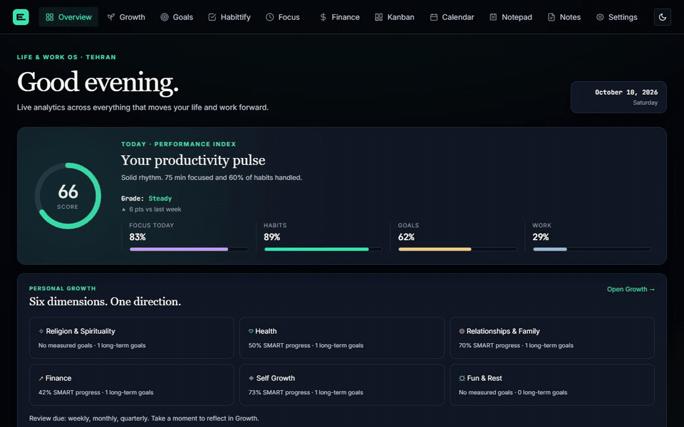

<div align="center">

# Edi Life OS

**Your habits, goals, focus, money and projects in one self-hosted dashboard that your AI assistant can use too.**

[](https://github.com/edrisranjbar/lifeos/releases) [](https://github.com/edrisranjbar/lifeos/stargazers) [](LICENSE) [](#with-docker-recommended) [](#talk-to-your-life-os-with-ai) [](#requirements)

**[Website](https://edrisranjbar.github.io/lifeos/)** · [Quick start](#quick-start) · [Tour](#a-quick-tour) · [AI / MCP](#talk-to-your-life-os-with-ai) · [Deploy](docs/deployment.md) · [API](docs/api.md) · [Donate](#donations) · [Contact](#contact) · **[Español](README.es.md)**

<br>



<sub>Tick a habit, ask Claude to log an expense, and see it land in Finance. The expense is written through the real API with sample data.</sub>

</div>

<br>

Most of us run our lives across a to-do app, a habit tracker, a budgeting spreadsheet, a Pomodoro timer and a notes app, and none of them know about each other. **Edi Life OS puts all of it in one calm, private dashboard** and connects the small things you do today to the direction you want your life to take.

- **Everything in one place.** Ten workspaces share one design, one sign-in and one database.
- **Connected, not just collected.** Habits drive goal progress, Kanban cards show up in the calendar, and the Overview turns it all into one daily score.
- **Yours.** Runs on any PHP + MySQL host, even cheap shared hosting. No subscription, no tracking, no vendor lock-in.
- **AI-ready.** A built-in MCP server lets Claude and other assistants read your dashboard, plan goals, log habits and track expenses for you.

> [!TIP]
> If Edi Life OS is useful to you, a ⭐ on GitHub helps other people find it.

## A quick tour

<picture>
  <source media="(prefers-color-scheme: dark)" srcset="docs/media/dashboard.webp">
  <source media="(prefers-color-scheme: light)" srcset="docs/media/dashboard-light.webp">
  
</picture>
<p><b>Overview</b> — One daily score built from focus, habits, goals and work, plus your six life dimensions at a glance.</p>

<table>
<tr>
<td width="50%" valign="top">
<picture>
  <source media="(prefers-color-scheme: dark)" srcset="docs/media/growth.webp">
  <source media="(prefers-color-scheme: light)" srcset="docs/media/growth-light.webp">
  
</picture>
<p><b>Growth</b> — Six life dimensions, each linked to long-term goals, SMART goals, habits and tasks. Guided weekly, monthly and quarterly reviews.</p>
</td>
<td width="50%" valign="top">
<picture>
  <source media="(prefers-color-scheme: dark)" srcset="docs/media/focus.webp">
  <source media="(prefers-color-scheme: light)" srcset="docs/media/focus-light.webp">
  
</picture>
<p><b>Focus</b> — Pomodoro sessions with breaks, a built-in focus soundtrack and a landscape that follows the time of day.</p>
</td>
</tr>
<tr>
<td width="50%" valign="top">
<picture>
  <source media="(prefers-color-scheme: dark)" srcset="docs/media/habittify.webp">
  <source media="(prefers-color-scheme: light)" srcset="docs/media/habittify-light.webp">
  
</picture>
<p><b>Habittify</b> — Small daily habits, streaks and a seven-day picture of your consistency.</p>
</td>
<td width="50%" valign="top">
<picture>
  <source media="(prefers-color-scheme: dark)" srcset="docs/media/kanban.webp">
  <source media="(prefers-color-scheme: light)" srcset="docs/media/kanban-light.webp">
  
</picture>
<p><b>Kanban</b> — Boards with labels, priorities, due dates, checklists, comments and attachments.</p>
</td>
</tr>
</table>

<details>
<summary><b>All ten workspaces</b></summary>

<br>

| Workspace | What you can do |
| --- | --- |
| **Overview** | A live productivity score, focus and habit trends, goals, finances and a seven-day weather forecast. |
| **Email** | Your recent inbox on the Overview and an AI summary of the last 24 hours each morning, from any IMAP mailbox with your own Claude, OpenAI, Gemini or OpenAI-compatible key. Read-only. [Guide](docs/email.md) |
| **Growth** | Connect six life dimensions to long-term goals, SMART goals, habits and tasks. Run weekly, monthly or quarterly reviews. [Guide](docs/growth.md) |
| **Focus** | Timed sessions with short and long breaks, session history and a focus soundtrack. |
| **Finance** | Expenses, income and budgets in the currency you choose in Settings (Toman by default). Debts you owe and credits owed to you, one-time or recurring, recorded straight into the ledger. [Guide](docs/financial-commitments.md) |
| **Habittify** | Daily habits with completion, streaks and monthly progress, on a Gregorian or Jalali calendar (Gregorian by default, set in Settings). |
| **Kanban** | Draggable cards and lists with priorities, labels, dates, checklists, comments and file attachments. Any card can be moved to Goals, where its checklist becomes the goal's tasks. |
| **Calendar** | Due cards and financial dues across all boards in Month or Schedule view. |
| **Goals** | SMART goals with measures, deadlines, priorities, editable and sortable checklists — or progress driven by a habit. Click a checklist title to edit it; save with Enter or cancel with Escape. |
| **Notepad** | Markdown notes with preview and export. Persian/Arabic and Hebrew notes automatically use RTL writing; mixed-language preview blocks detect their own direction, while code stays LTR. |
| **Notes** | Sticky notes with colors, fonts and connections. |

Dates follow **Asia/Tehran**. The weather card shows Qeshm Island via Open-Meteo; its tide figure is a modeled estimate, not for navigation.

</details>

## Talk to your Life OS with AI

Edi Life OS ships with an optional [MCP](https://modelcontextprotocol.io) server that exposes **15 tools** across your dashboard, goals, tasks, habits, finances and notes. Connect it to Claude Desktop, Claude Code or any MCP client and ask in plain language:

> *"Show me my LifeOS dashboard."*
>
> *"Create a SMART goal called Build a home studio, due in three months, and add Buy acoustic panels as a task."*
>
> *"Mark Reading complete for today."*
>
> *"Log a 450,000 Toman food expense and show my balance."*

The MCP server talks to your app only through its token-protected HTTP API. It never touches your database or credentials. Setup takes a minute — see [MCP server](#mcp-server) below.

## Quick start

### With Docker (recommended)

```sh
git clone https://github.com/edrisranjbar/lifeos.git && cd lifeos
cp .env.example .env    # set your sign-in and passwords
docker compose up -d
```

Open [localhost:8080](http://localhost:8080) and sign in. MySQL, the app and your attachments each live in their own volume, so `docker compose up -d --build` after a `git pull` upgrades without losing data.

**No git, no build:** run the published image (amd64 and arm64, so it works on a Raspberry Pi too).

```sh
curl -fsSLO https://raw.githubusercontent.com/edrisranjbar/lifeos/main/docker-compose.image.yml
curl -fsSL https://raw.githubusercontent.com/edrisranjbar/lifeos/main/.env.example -o .env   # then set your sign-in and passwords
docker compose -f docker-compose.image.yml up -d
```

Upgrade later with `docker compose -f docker-compose.image.yml pull && docker compose -f docker-compose.image.yml up -d`.

### On shared hosting

Download `lifeos-<version>.zip` from the [latest release](https://github.com/edrisranjbar/lifeos/releases/latest) and extract it into your hosting **home directory**, so `public_html/` becomes your web root and the backend sits safely above it. Copy `config.example.php` to `config.php`, fill in your MySQL details, and open your site. See the [deployment guide](docs/deployment.md) for details.

### With PHP locally

You need **PHP 8.1+** (with `pdo_mysql` and `mbstring`) and **MySQL 8+** (or MariaDB 10.4+).

```sh
git clone https://github.com/edrisranjbar/lifeos.git
cd lifeos
cp config.example.php config.php   # PowerShell: Copy-Item config.example.php config.php
```

Edit `config.php` with your database connection and the username and password you want to sign in with, then start the server:

```sh
php -S localhost:8000 -t public_html server.php
```

Open [localhost:8000](http://localhost:8000) and sign in. The database and tables are created on first use. Use **Settings → My account** to change your sign-in, or **Settings → Accounts** to add administrators with their own passwords and private workspaces. [Account guide](docs/accounts.md)

> [!IMPORTANT]
> `config.php` and `.env` hold real credentials and are gitignored. Never commit them.

### Requirements

| Component | Requirement |
| --- | --- |
| PHP | **8.1+** with `pdo_mysql` and `mbstring` |
| Database | **MySQL 8+**; also tested with MariaDB 10.4 |
| Web server | PHP's built-in server locally; Apache with rewrites for hosting |
| Weather | PHP `curl` and outbound HTTPS |
| MCP server | Optional: **Node.js 22.9+** |
| API tests | Optional: `pdo_sqlite` |

## API and integrations

### HTTP API

A private `/api/v1` API covers the dashboard, goals, tasks, habits, finances and sticky notes. It uses its own bearer token, separate from your browser sign-in.

```sh
php -r "echo bin2hex(random_bytes(32));"
```

Set the result as `api_token` in `config.php` (or the `LIFEOS_API_TOKEN` environment variable), then:

```sh
curl -H "Authorization: Bearer $LIFEOS_API_TOKEN" https://your-host/api/v1/dashboard
```

See the [API reference](docs/api.md) for endpoints, payloads and errors.

### MCP server

```sh
cd mcp
npm ci
cp .env.example .env   # set LIFEOS_BASE_URL and LIFEOS_API_TOKEN
npm start
```

The server runs over **stdio**; there is no hosted MCP endpoint. The [MCP guide](mcp/README.md) lists every tool and shows client configuration for Claude and Codex.

## Your data stays yours

- Everything lives in **your** MySQL database. Habits use dedicated tables; other workspaces store JSON documents in `app_state`.
- Saves use revision checks, so a stale tab can't silently overwrite newer changes. API writes use transactions and row locks.
- Data from older browser-only versions is imported once; conflicting copies are archived as `legacy_backup_*` records.
- Back up the database, attachment files and your configuration together.

Moving from the old Habittify SQLite database? See [migrating Habittify](docs/deployment.md#migrating-habittify-from-sqlite).

## Security

Edi Life OS supports **multiple administrators with separate private data**. Every account can manage accounts; this does not grant access to another account's records through the app. Administrators can reset other users' passwords, so invite only people you trust.

- The operator API token grants read and write access to supported domains for one active account (`api_user_id`, default `1`). Per-user token issuance, token scopes and API rate limiting are not implemented, so set request limits at the hosting layer.
- Use HTTPS anywhere other than localhost, and keep tokens out of URLs, frontend code, screenshots and logs.
- Secret notes are hidden from API reads by default. The secret flag controls visibility; it is not separate encryption.

## Project structure

```text
public_html/          Browser workspaces, shared assets and Apache entry points
lib/                  API domains, response helpers and state transactions
mcp/                  Optional Node.js stdio MCP server
tests/                Timer, API, MySQL and integration checks
docs/                 Guides, plus README screenshots in docs/media
config.example.php    Configuration template (no real credentials)
server.php            Development router and application routing
api.php               HTTP API entry point
```

Built with PHP, MySQL and vanilla JavaScript — no frontend build step, no framework.

`Dockerfile`, `docker-compose.yml` and `docker/config.php` run the app with configuration from environment variables.

## Documentation

- [API reference](docs/api.md) — authentication, routes, data formats and concurrency
- [MCP guide](mcp/README.md) — tools, environment settings and client setup
- [Deployment guide](docs/deployment.md) — Apache, shared hosting, backups and migration
- [Troubleshooting](docs/troubleshooting.md) — common first-run issues, causes and solutions
- [Development guide](docs/development.md) — local checks and disposable integration fixtures
- [Growth workspace](docs/growth.md) · [Debts and credits](docs/financial-commitments.md) · [Email and daily summary](docs/email.md)

## Donations

If Edi Life OS is useful to you, consider supporting its development with a donation.

**[Donate through Donatr](https://donatr.ee/edicodes)** — choose an available donation method on my public page.

[Toman payment Gateway](https://edrisranjbar.ir/donation)

You can also donate directly to these public receiving addresses:

| Cryptocurrency | Network | Receiving address |
| --- | --- | --- |
| Bitcoin (BTC) | Bitcoin (on-chain) | `bc1qdwdpeqv0l8ala8tm46rtfeghuxl70een84npj3` |
| Ether (ETH) | Ethereum mainnet | `0x695CCF873d51E4C2dC1321b405C63BFE99c5a536` |
| Solana (SOL) | Solana mainnet | `C2d9u9nY2hZfxsi5Fwz1o5VjGGQujWmxeqZ3upKvHBfD` |

Send only the listed cryptocurrency on the specified network.

## Contact

For questions, feedback or collaboration, email **[edris.qeshm2@gmail.com](mailto:edris.qeshm2@gmail.com)**.

For bugs and feature requests, please [open a GitHub issue](https://github.com/edrisranjbar/lifeos/issues/new/choose) so the discussion is easy to follow.

## License

[MIT](LICENSE) © 2026 Edris Ranjbar. Use it, fork it and build on it.

## Contributing

Ideas, bug reports and pull requests are welcome. Read the [contributing guide](CONTRIBUTING.md) to get set up, and look for [`good first issue`](https://github.com/edrisranjbar/lifeos/labels/good%20first%20issue) if you want somewhere to start.

<div align="center">
<br>

**If Edi Life OS helps you run your days, consider giving it a ⭐ — it helps others find it.**

</div>
